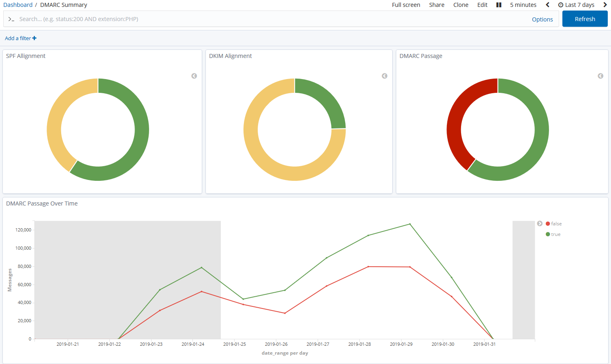
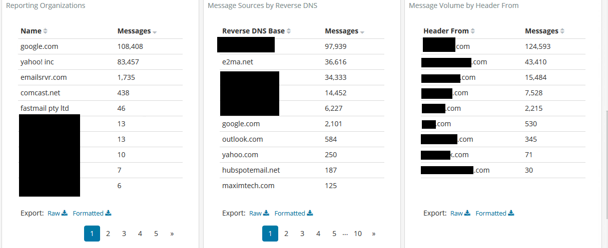
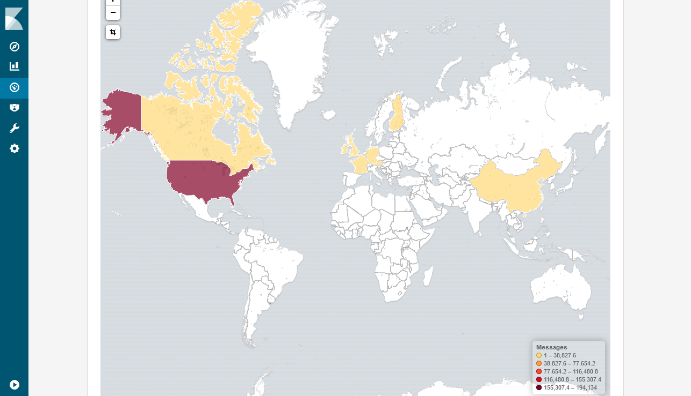
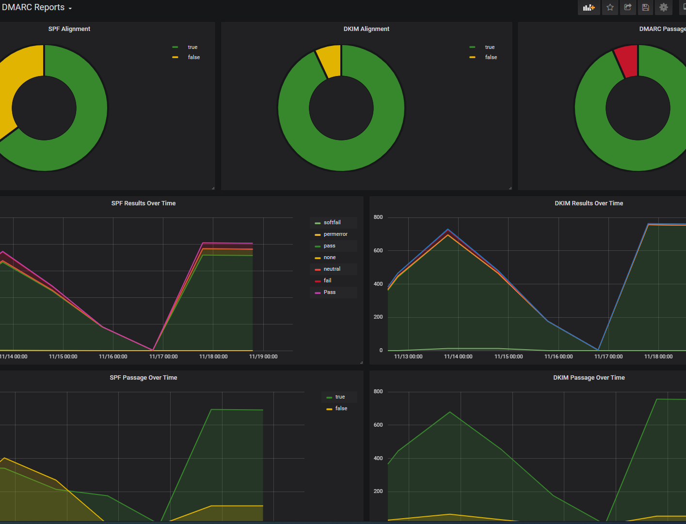
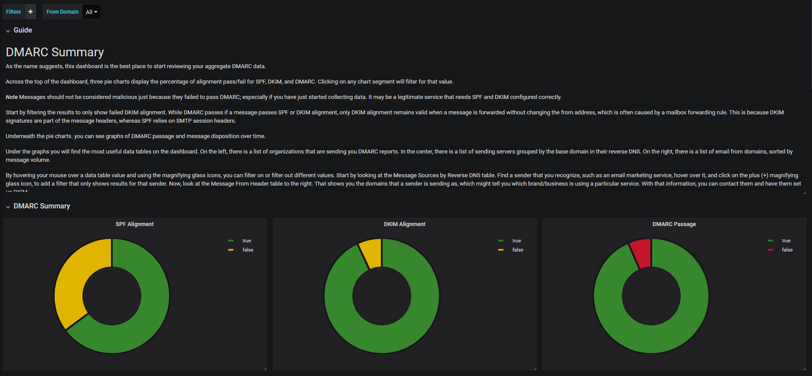

tsdmarc writes exactly the documents, rows and events parsedmarc writes, so parsedmarc's premade dashboards work unchanged. They are included in the repository's [`dashboards/`](https://github.com/helixnebulatech/tsdmarc/tree/main/dashboards) directory (copied from parsedmarc, Apache-2.0):

| File | For |
| --- | --- |
| `dashboards/opensearch/opensearch_dashboards.ndjson` | OpenSearch Dashboards **and** Kibana (saved objects) |
| `dashboards/grafana/Grafana-DMARC_Reports.json` | Grafana with Elasticsearch/OpenSearch data sources |
| `dashboards/grafana/Grafana-DMARC_Reports-PostgreSQL.json` | Grafana with the PostgreSQL output |
| `dashboards/grafana/Grafana-DMARC_Reports-Loki.json` | Grafana with the [Loki output](../outputs/#grafana-loki) |
| `dashboards/splunk/*.xml` | Splunk (aggregate, failure and SMTP TLS views) |

The screenshots on this page come from parsedmarc's documentation.

## Kibana and OpenSearch Dashboards

1. Save reports with the [Elasticsearch or OpenSearch output](../outputs/).
2. In Kibana or OpenSearch Dashboards, open **Stack Management → Saved Objects → Import** (OpenSearch Dashboards: **Dashboards Management → Saved objects → Import**).
3. Import `opensearch_dashboards.ndjson`. Kibana 8.x accepts the OpenSearch Dashboards format directly, so there is no separate Kibana export.

The default dashboard is _DMARC aggregate reports_; switch dashboards with the Dashboard link on the left menu.

### DMARC aggregate reports

The best place to start reviewing your aggregate DMARC data. Three pie charts at the top show the percentage of alignment pass/fail for SPF, DKIM and DMARC; clicking a segment filters on that value.

:::note
Don't consider messages malicious just because they failed DMARC, especially when you've just started collecting data. It may be a legitimate service that needs SPF and DKIM configured correctly.
:::

Start by filtering on failed DKIM alignment. A message passes DMARC with either SPF or DKIM alignment, but only DKIM alignment survives forwarding without changing the From address (often a mailbox forwarding rule), because DKIM signatures are part of the message while SPF relies on the SMTP envelope.

Below the charts are graphs of DMARC compliance and message disposition over time, then the most useful tables:

- the organizations sending you DMARC reports;
- sending servers grouped by the base domain of their reverse DNS;
- _Message volume and DMARC compliance by from domain_.

Hover over a value and use the magnifying glass icons to filter on it or out. For example, find a sender you recognize (such as an email marketing service) in _Message sources by reverse DNS_, filter on it, and look at the _by from domain_ table to see which of your domains it sends as and how much of that traffic passes DMARC, then ask its owner to set up DKIM.

:::note
If you have many B2C customers, you may see a lot of email "from" your domains coming from consumer services such as Gmail and Yahoo. This comes from customers forwarding mail from old accounts to new ones, which is why DKIM is so important. Similar patterns appear with parent, subsidiary and outdated brands.
:::

Further down, filter by source country or IP address, and see SPF and DKIM details. Each row of the DKIM details table is one DKIM signature, shown as `selector / domain / result` (SPF: `scope / domain / result`); a message with several signatures appears once per signature, so summing the messages column can exceed the total.

### DMARC failure reports

Shows failure (ruf, formerly forensic) reports: samples of emails that failed DMARC. Most receivers don't send failure reports at all to avoid privacy leaks, some only send headers, and very few send the whole email.

### SMTP TLS reporting

Aggregate counts of TLS-RPT reporting organizations, the policy domains they report on, and the failure types (certificate expiry, STARTTLS not supported, STS policy fetch errors, validation failures, …) with the sending and receiving MTAs involved.

## Grafana

- **Elasticsearch or OpenSearch:** create two Elasticsearch data sources, `dmarc-ag` for the `dmarc_aggregate*` indexes and `dmarc-fo` for `dmarc_f*` (which matches both `dmarc_failure*` and the older `dmarc_forensic*`), then import `Grafana-DMARC_Reports.json`.
- **PostgreSQL:** add a PostgreSQL data source for the database tsdmarc writes to, then import `Grafana-DMARC_Reports-PostgreSQL.json`.
- **Loki:** import `Grafana-DMARC_Reports-Loki.json` and pick your Loki data source for its `DS_LOKI` input. It has the PostgreSQL dashboard's layout, with LogQL queries filtered by the `domain` stream label, and expects the default `job=parsedmarc` label and `label_fields`.

The Grafana dashboards were contributed to parsedmarc by GitHub user Bhozar.

## Splunk

The `dashboards/splunk/` directory has XML views for aggregate reports (`dmarc_aggregate_dashboard.xml`), failure reports (`dmarc_failure_dashboard.xml`) and SMTP TLS reports (`smtp_tls_dashboard.xml`). Copy each file's contents into a new Splunk dashboard's XML source editor.

:::caution
Replace every `index="email"` in the XML with your own index name.
:::

The Splunk dashboards show the same content and layout as the Kibana ones, although Kibana's filtering is a bit easier and more flexible.

## Upgrading from older dashboards

Dashboards from recent parsedmarc versions read combined `dkim_results_combined` / `spf_results_combined` fields. tsdmarc backfills them into documents saved by older versions at startup (see [Elasticsearch](../outputs/#elasticsearch)); parsedmarc's [backfill documentation](https://domainaware.github.io/parsedmarc/elasticsearch.html#backfilling-the-combined-dkimspf-result-fields) has a manual `_update_by_query` command if you'd rather run it yourself.
